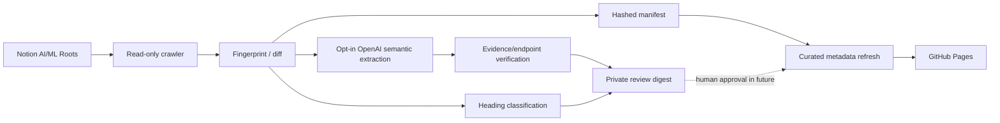

# Architecture

## Goal

Keep the AI & ML knowledge atlas current while maintaining Notion as the authoritative document store. New or modified content is evaluated for potential concepts, but the source workspace is not changed automatically.

## Workflow



### Current source roots

- Machine Learning
- LLM Finetuning
- Agentic AI
- Neo4j / Knowledge Graphs

The crawler follows child-page links and nested block-children; defaults are bounded to 250 pages and block depth 5. Integration permissions determine which pages can be read. Read errors stop the publication/state update rather than treating pages as deleted.

### Incremental semantics

The crawler gathers all accessible pages within scope. For each page, it computes SHA-256 of a normalized representation of its blocks, compares this against the committed prior manifest and classifies the page as baseline, unchanged, added or modified. Pages absent from a **complete** scan are only flagged as potentially missing; nothing is deleted from the graph automatically.

**Important:** This version saves LLM processing work, but still walks accessible pages and blocks to detect changes. Metadata-first scans and cached parent subtrees are a future optimization. It is not yet a fully incremental Notion API crawler.

### State and publication boundary

```text
knowledge-graph/
  index.html             Public graph with curated nodes
  maintain.py            Notion crawler, page diff, candidate digest
  semantic_extract.py     Strict LLM extraction and evidence validation
  test_semantic_extract.py Offline provenance tests
  refresh_curated.py     Update source freshness on existing nodes only
  test_maintain.py       Offline unit tests
  state/manifest.json    Hashed page identifiers + fingerprints + edit timestamps
.github/workflows/
  sync-ai-ml-graph.yml   Daily/manual workflow
doc/
  README.md
  architecture.md
  data-model.md
  operations.md
```

The public site remains a curated snapshot; automated detection does **not** push new unreviewed notes directly to the website. Source freshness timestamps for existing curated nodes can update automatically.

### Failure model

- Missing token: workflow exits without changing data.
- Notion read failure or scan cap: engine fails and leaves manifest and webpage unchanged.
- Notification failure: run fails before advancing the manifest; retry could send another digest if state commit previously failed.
- Git push conflict: job fails; rerun after reconciling the branch.
- No detected changes: manifest timestamp can advance, but webpage stays stable.

### Future phases

1. Approved candidate queue with stable IDs and private storage.
2. LLM-based concept extraction with citations to exact blocks.
3. Cross-page entity resolution and relationship inference with measured confidence; per-page semantic proposals are already available as private opt-in email.
4. Notion change-log database and approval UI; structural writes only after human approval.
5. Event-driven scans plus weekly exhaustive reconciliation.

## Design constraint

Do not treat course pages, tools, knowledge topics and atomic concepts as interchangeable graph nodes. See [data model](data-model.md).
