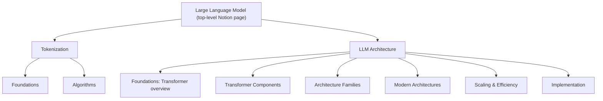

# Large Language Model Domain Migration

## Status

Completed as a curated taxonomy and Notion learning-hub move on 2026-11-21.

- [Large Language Model — Notion root](https://app.notion.com/p/41f75fdeb6eb812eaac8d3fbf4bc31e4)
- [Tokenization — learning hub](https://app.notion.com/p/41c75fdeb6eb8127a34fcf84655a5313)
- [LLM Architecture — learning hub](https://app.notion.com/p/41c75fdeb6eb81c389c0e7f2bb1ab223)
- [Node Registry](https://app.notion.com/p/0a30f98a97504d46ac38645b24f7ac1f)
- [Personal Knowledge Atlas — project hub](https://app.notion.com/p/41675fdeb6eb81649a8df5feaa898774)

## Notion organization

The two **existing learning hubs** were moved, not recreated. Child pages followed their existing parents. Their canonical Node Registry rows remain inside the centralized Knowledge Atlas database under the project hub. Original CS336/CME295 source notes were **not moved**; they remain linked as provenance.

## Concept graph

- New graph domain node: `llm-domain` — **Large Language Model**.
- The existing `llm` topic now has parent `llm-domain` instead of `ml`. `llm-domain` is a domain node nested under the broad `ml` umbrella.
- Canonical main concept nodes `token` (display name **Tokenization**) and `llm-architecture` retain their `llm-found` parents and existing stable IDs.
- Their descendants retain all existing parent relationships.
- Graph node property `domain` is set to `Large Language Model` for the full LLM subtree. Other nodes retain `AI & ML`.
- The webpage's Node Inspector now displays Domain. The sidebar includes the new branch and direct shortcuts to Tokenization and LLM Architecture.

## Node Registry

A new `Large Language Model` Select option was added to the **Domain** property. The registry now includes the new domain node and five previously missing architecture-module rows.

All LLM-subtree registry rows were classified `Domain = Large Language Model`. Existing tags, review statuses, source links, breakdown decisions, and node IDs were preserved. The registry remains the centralized tracking space; it is **not** moved into the new learning domain page.

## Code updates

- `knowledge-graph/index.html`: domain node, per-node classification, hierarchy, explorer filters, inspector.
- `knowledge-graph/maintain.py`: a new Notion source root, and LLM Finetuning's mapping to `llm-domain`.
- `knowledge-graph/semantic_extract.py`: `llm-domain` as an eligible parent classification.
- `knowledge-graph/review_queue.py`: accepts `llm-domain` in approved concepts.
- `knowledge-graph/sync_node_registry.py`: reads the graph node's `domain` instead of hardcoding `AI & ML`; future runs preserve the new classification.
- `knowledge-graph/test_workspace_taxonomy.py`: tests updated source-root mapping.

## Scope and caveats

1. **Learning-space reorganization:** only the Tokenization and LLM Architecture learning hubs, including their existing descendants, moved to the new Notion root.
2. **Semantic classification:** the currently registered LLM graph subtree now has the new Domain label, including existing LLM courses and post-training nodes; their original Notion pages were not moved.
3. **No destructive migration:** original learning notes and centralized registry records remain intact.
4. **Source integration:** The automatic scheduled workflow still requires configured Notion tokens and has not been verified end-to-end as part of this change.
5. **Future LLM sections:** classify new knowledge under `llm-domain`, and separately decide whether its *learning page* should reside under the new Notion root.

## Next expansion

The `Large Language Model` domain can eventually include training, fine-tuning, evaluation and inference learning hubs. Do not move or publish existing private Notion pages without reviewing their content and access rules first.
