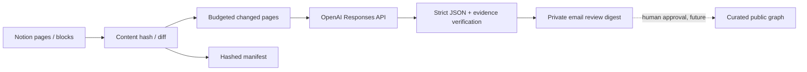

# LLM-Powered Semantic Extraction

**Status:** Implemented as an opt-in, private daily review pipeline with optional persistent Notion review queue. No live model call has been verified until credentials are configured.

## Why this exists

The earlier crawler only discovered pages and headings. This component reads changed Notion **block text** and uses an LLM to propose atomic concepts, definitions, topic placements, prerequisites, and semantic relations, with evidence that reviewers can trace to source blocks.

It never writes to Notion, and new LLM proposals are not automatically published to the public graph.

## Data flow



## API and output schema

The implementation is `knowledge-graph/semantic_extract.py` and uses the [OpenAI Responses API](https://developers.openai.com/api/reference/resources/responses/methods/create) with strict JSON Schema structured output, `store=false`, and a configurable model (default `gpt-4o-mini`).

Each concept proposal includes:

| Field | Meaning |
|---|---|
| `name` | Canonical concept name candidate |
| `definition` | Short grounded description |
| `parent_id` | Suggested curated topic |
| `synonyms` | Candidate aliases |
| `confidence` | Model-assigned high/medium/low; not calibrated |
| `evidence` | Exact source block ID and verbatim quote |
| `review_status` | Always `proposed` |

Each relation includes `source`, `target`, `type`, `confidence`, `evidence`, and `review_status`. Valid types currently include `PREREQUISITE_OF`, `IS_A`, `RELATED_TO`, `PART_OF`, `APPLIED_IN`, `EXPLAINS`.

The validator **discards** concepts without a valid evidence quote present in a supplied block; it also rejects relation endpoints absent from the validated concept set. This is a basic provenance safeguard, not proof that a model inference is true.

## Runtime limits

- Maximum changed pages per run: `SEMANTIC_MAX_PAGES_PER_RUN` (default 5).
- Maximum input text per note: `SEMANTIC_MAX_INPUT_CHARS` (default 13,000).
- Maximum response tokens per note: `SEMANTIC_MAX_OUTPUT_TOKENS` (default 2,400).
- Strict response is capped in postprocessing at 8 concepts and 10 relations per note.
- Extra changed pages stay deferred by restoring their prior fingerprint, so later scheduled runs can retry them.
- First scan creates a baseline; to include old notes in extraction, configure `SEMANTIC_BACKFILL_BASELINE=true` **before the first successful scan**, or change notes after the baseline.

**Important:** This version only sends the beginning of each note up to the input budget. Long notes may need chunked extraction in a future version. Page scans still traverse full block content for change hashing.

## Configure

In the repository's Settings → Secrets and variables → Actions:

**Secrets**
- `NOTION_TOKEN`: Notion integration with read access to selected AI/ML pages
- `OPENAI_API_KEY`: API credential enabling semantic extraction
- Either private Notion queue (`NOTION_REVIEW_TOKEN` and `NOTION_REVIEW_DATA_SOURCE_ID`) **or** SMTP email credentials (`SMTP_HOST`, `SMTP_USERNAME`, `SMTP_PASSWORD`, `REPORT_EMAIL_TO`) must be configured as a private review destination. Configure both for database review and an email digest.

**Optional variables**
- `OPENAI_MODEL`: defaults to `gpt-4o-mini`
- `SEMANTIC_MAX_PAGES_PER_RUN`: defaults to `5`
- `SEMANTIC_BACKFILL_BASELINE`: defaults to `false`
- `SMTP_PORT`: defaults to `465`

Setting `OPENAI_API_KEY` without either a private review queue or SMTP credentials causes the job to fail **before sending any content to the model**. Without `OPENAI_API_KEY`, the legacy non-LLM scan remains active.

## Privacy and safety

- **Third-party transfer:** enabling `OPENAI_API_KEY` explicitly sends selected text from your private Notion pages to the OpenAI API. Review the organization's privacy and data-processing requirements before activation.
- **No automatic publication:** the public graph stays curated; unreviewed concepts, quotes, page bodies, and private email reports are not checked into Git.
- **No Notion writes:** model-generated text cannot move, overwrite, or edit Notion pages.
- **Prompt injection resistance:** page text is treated as untrusted data and model output is restricted to schema. However, an LLM can still produce incorrect classifications.
- **Credentials:** store keys only as GitHub Actions secrets. Never include them in source, git commits, or logs.
- **Data retention:** model API request sets `store=false`. This controls response storage behavior; consult the API provider's data-use/retention terms for further detail.
- **Email:** block evidence quotes and Notion URLs are mailed to the configured address. The pipeline stores neither detailed candidates nor raw texts in its committed manifest.
- **Reviews are not durable:** the current email digest is an actionable review proposal, but does not yet provide a persistent approval database or an approved-publication mechanism.

## Failure / recovery

1. A malformed, refused, incomplete or failed model response aborts the daily job before advancing the manifest; rerun after resolving it.
2. Invalid individual evidence claims are discarded; other valid claims survive.
3. If email delivery fails, the job does not advance the manifest, so proposals are generated again on retry.
4. If a commit fails after mail succeeds, the digest may be sent again on retry. Exactly-once notifications are **not** guaranteed.
5. A page limit defers excess notes rather than marking them processed.

## Tests

Run offline unit tests:

```bash
python3 -m unittest discover -s knowledge-graph -p 'test_*.py' -v
```

Tests check evidence quote validation, invalid block IDs, non-existent relationship endpoints, duplicate concept candidates, structured schema, and existing manifest behavior. No OpenAI API calls are made in tests.

## Next work

Build a private candidate review database with approval status and stable concept IDs; add page chunking and cross-page entity resolution; add evaluation metrics and a controlled publish step after approval.
