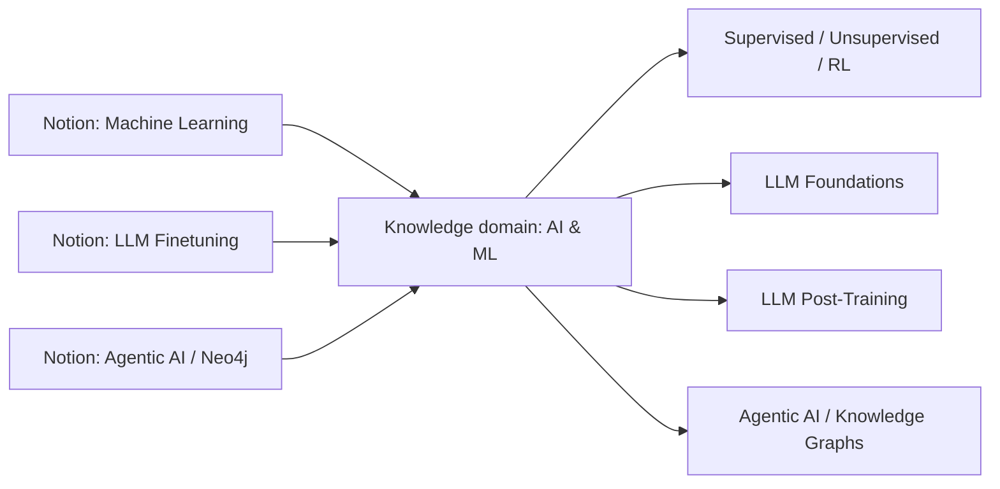

# Workspace Scope and Source-to-Domain Taxonomy

## Vision

The **Personal Knowledge Atlas** is a workspace-wide semantic knowledge index sourced from Notion. Its project coordination hub lives in the **top-level Private sidebar**, not inside any particular subject collection. The interactive site currently publishes the **AI & Machine Learning** pilot; additional Notion domains will be onboarded incrementally.

## Two layers of organization

Notion's page hierarchy is the **source structure** and does not necessarily match the **concept taxonomy**. We keep both rather than rearranging the user's personal learning notes.

| Notion root | Root page ID | Semantic domain | Notes |
|---|---|---|---|
| Machine Learning | `963f7995-6cee-49e0-a857-07ca6e3a4853` | `ml` (AI & ML) | Initial ML, RL, LLM notes |
| LLM Finetuning | `3f275fde-b6eb-809c-8ff0-de72173259bb` | `ml` (AI & ML) | CME295 + CS336, tokenization, training |
| Agentic AI | `28f75fde-b6eb-8048-9783-cf7af2337650` | `ml` (AI & ML) | Agent workflows |
| Neo4j | `19e75fde-b6eb-80bc-bb83-f5c1c80a6e09` | `ml` (AI & ML) | Knowledge graphs, Cypher, GraphRAG |

The source registry lives in `knowledge-graph/maintain.py` as `SOURCE_ROOTS`. The top-level LLM Finetuning root was **already included** in the crawler; the new change formalizes its classification alongside Machine Learning and expands the *public graph's* source/course representation.

## Concept deduplication

CS336's Tokenization lecture and the separate Tokenization page refer to the same knowledge concept. Store them as different **Note / Source** nodes with `COVERS` or `EXPLAINS` links to the canonical **Concept** node. Do not merge or delete the original Notion notes.

For now, source-to-concept mappings for newly added course notes are curated candidate links; they have not been independently verified from full lecture content. Semantic extraction continues to require block-level evidence for its proposals.

## Current public graph changes

- Renamed the graph's existing root label to **AI & Machine Learning**, preserving ID `ml` for compatibility.
- Added source nodes for both Machine Learning and LLM Finetuning.
- Added CME295 lecture nodes and additional CS336 notes.
- Retained existing canonical concepts such as Tokenization, Transformers and LLM Training.
- Added source-mapping edges to existing concepts.
- Preserved `llm`, `llm-found`, `posttrain` and other IDs used by the review publisher.

There are **50 curated graph nodes** and **22 semantic/source mapping edges**, with additional hierarchy edges calculated in the browser. These are curated initial values, not counts from a full automated workspace extraction.

## Adding future Notion sections

1. Identify the actual Notion top-level source page or database and confirm access.
2. Decide whether it belongs to an existing semantic domain or requires a new domain.
3. Register the root in `SOURCE_ROOTS`, ensuring the Notion read integration has access.
4. Add/adjust the public graph taxonomy and the LLM extractor's allowed `PARENT_IDS`.
5. Add corresponding allowed parent IDs to `review_queue.py` and test that approvals resolve properly.
6. Preserve originals as `Source` / `Note` nodes; create new semantic `Concept` nodes only after review.
7. Run offline tests and a manually triggered maintenance workflow. Audit the resulting private candidates before approval.

**Do not** automatically add every top-level Notion page to public GitHub Pages. That would risk leaking private titles, content or source links. Onboarding is explicit and reviewed.

## Project pages

- [Project hub in top-level Notion Private sidebar](https://app.notion.com/p/41675fdeb6eb81649a8df5feaa898774)
- [Public knowledge atlas](https://ianchen0316.github.io/knowledge-graph/)
- [Private concept review queue](https://app.notion.com/p/81c1042e9043420cb167912d483ee33a)

## Future domain candidates

Examples discovered during the earlier representative workspace audit: Computer Science, Data / Cloud Engineering, Economics & Finance, Philosophy, Travel & Lifestyle, and Personal / Professional. These are **not yet enabled in the crawler or published graph**.

See [Architecture](architecture.md), [Data model](data-model.md), and [Operations](operations.md).
